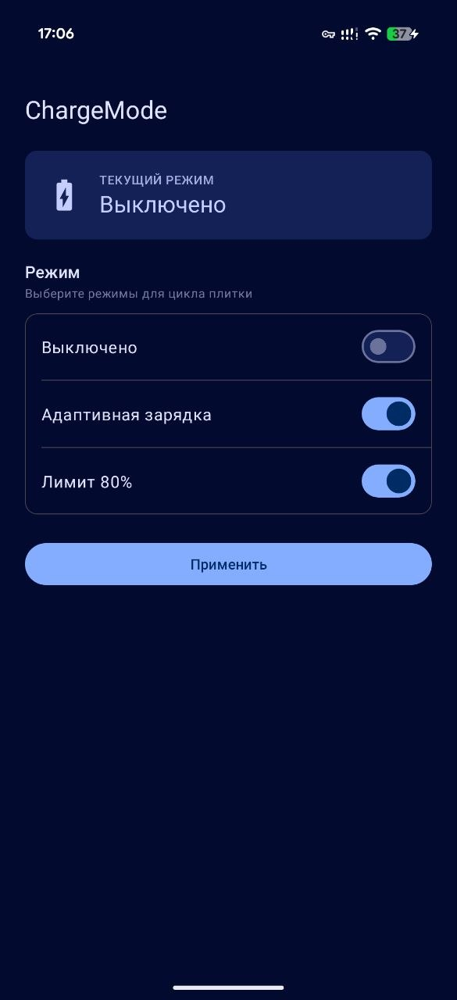
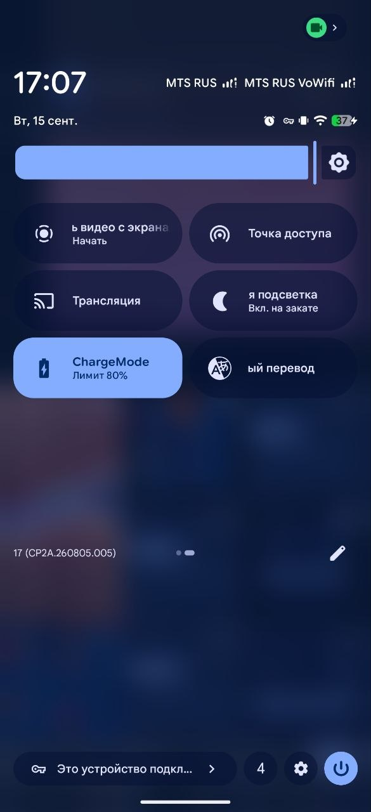
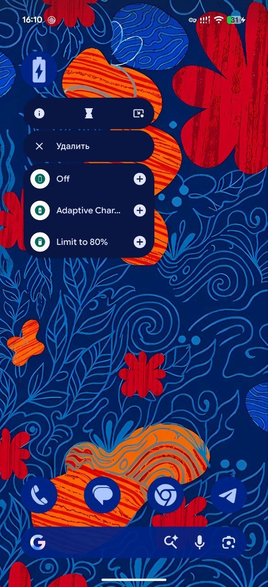

# ChargeMode

A Quick Settings tile that switches the charging mode of a Google Pixel with one tap.

> **Pixel only.** The charging modes are a feature of Google Pixel phones, not of Android
> itself. Phones of other makers — Samsung, Xiaomi, OnePlus and the rest — have battery
> protection of their own, built differently, and ChargeMode cannot switch it. On such a
> phone the app opens and says that the device is not supported.

Some days you need a full battery before leaving the house; on most days you would rather
spare it. A Pixel can do both — charge to 100% or stop at 80% — but the switch is several
screens deep in Settings. ChargeMode puts it one tap away.

  
  
  

## What it does

- **A tile in Quick Settings.** Every tap moves to the next mode; the tile shows the one
  that is on. A long press opens the app.
- **Three modes**, the same ones Settings → Battery → Charging optimization offers:
  - **Off** — plain charging to 100%;
  - **Adaptive Charging** — holds at 80% and reaches 100% shortly before you usually unplug;
  - **Limit to 80%** — stops at 80%.
- **You choose the cycle.** Leave only the modes you switch between — say, Adaptive Charging
  and Limit to 80% — and the tile skips the rest.
- **Shortcuts on the app icon.** A long press on the icon sets a mode directly.
- No ads, no internet access, no root.

## Requirements

- A Google Pixel phone
- Android 15 or newer — the 80% limit came to Pixels with this version
- [Shizuku](https://shizuku.rikka.app/), installed and running

## Setup

1. Install [Shizuku](https://shizuku.rikka.app/) and start it.
2. Install ChargeMode from the [latest release](https://github.com/bl3xand/ChargeMode-QuickTile/releases/latest)
   and open it. Grant it Shizuku access when asked.
3. Pick the modes the tile should cycle through and tap **Apply**.
4. Add the **ChargeMode** tile to Quick Settings.

The app is available in English, Russian and Chinese.

## How it works

The modes are two settings of the system that an ordinary app may neither read nor write.
ChargeMode asks Shizuku once for the permission to write them, and reads the current mode
through Shizuku every time, so the tile always shows what is really set — also after you
change the mode in Settings yourself.

## License

[MIT](LICENSE)
